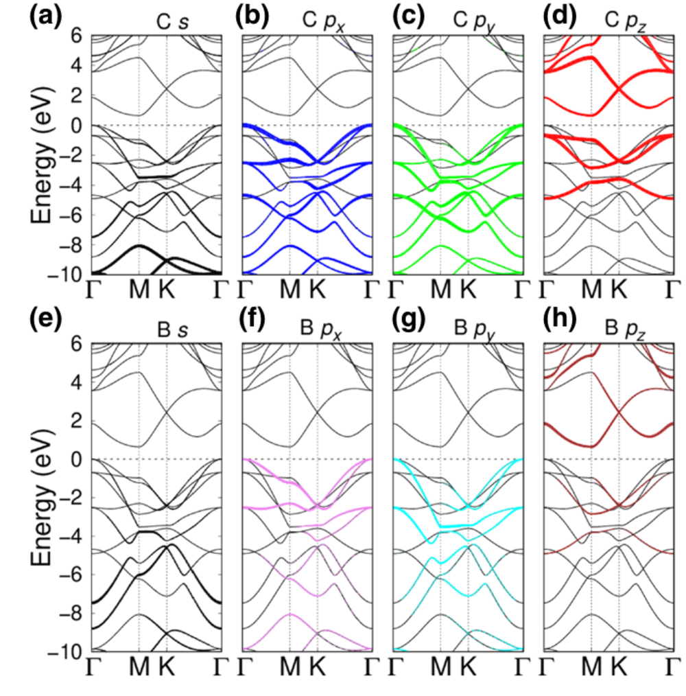

课题组关于石墨烯衍生二维硼碳材料 C₃B 的研究以 “Remarkable Band-Gap Renormalization via Dimensionality of the Layered Material C₃B” 为题发表于 *Physical Review Applied*。

<!--more-->

*图：C₃B 近带边 Bloch 波函数的原子轨道分解，显示导带底与价带顶具有不同的轨道来源。图源：论文 Fig. 3。*

在 C₃N 工作之后，课题组进一步关注其电子-空穴对称意义上的近邻体系 C₃B。C₃B 同样保持类石墨烯蜂窝骨架，但用硼原子调控碳网络的电子结构。这样一个简单而高度有序的二维材料，为研究成分替换、层间耦合和介电屏蔽如何共同改变带隙提供了理想模型。

该工作结合密度泛函理论和 GW 准粒子计算，发现 C₃B 的电子结构具有极强的维度依赖性：单层 C₃B 的准粒子带隙约为 2.55 eV，而在理想堆叠的块体相中可降至约 0.17 eV。从单层到块体，带隙变化超过 2.3 eV，远大于许多常见二维半导体中的层数效应，体现出层状 C₃B 中异常强的带隙重整化。

这种巨大变化并不是简单的“层数越多带隙越小”现象，而来自层间相互作用和介电屏蔽的共同调制。研究进一步指出，C₃B 的导带底主要与面外电子态相关，而价带顶更多来自面内电子态。这种近边电子态的轨道分工意味着，外部环境、层间距离、应变或堆叠方式可能分别作用于电子和空穴通道，为更精细的能带工程提供了可能。

该结果把 C₃B 推到了一个非常有意思的位置：同一种材料可以在单层中表现为中等带隙半导体，而在块体或多层中接近窄带隙体系。它既是理解低维材料准粒子重整化的模型体系，也为后续利用 C₃B 与 C₃N 构建范德华异质结构、调控光吸收和激子行为提供了材料基础。

论文信息：Yabei Wu, Weiyi Xia, Yubo Zhang, Wenguang Zhu, Wenqing Zhang, and Peihong Zhang, *Physical Review Applied* **14**, 014073 (2020). DOI: [10.1103/PhysRevApplied.14.014073](https://doi.org/10.1103/PhysRevApplied.14.014073)。
