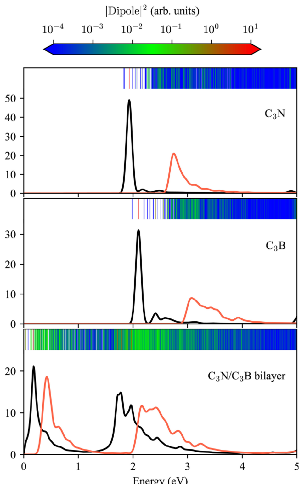

课题组合作研究将电子富集的 C₃N 与电子匮乏的 C₃B 堆叠成范德华异质结，预测其可产生强烈的中红外到远红外层间激子吸收，相关成果发表于 *Physical Review Applied*。

<!--more-->

*图：C₃N、C₃B 单层与 C₃N/C₃B 双层的介电函数虚部对比，双层体系在低能区域出现显著层间激子吸收。图源：论文 Fig. 3。*

远红外与太赫兹波段在热成像、生物医学检测、痕量探测、大气和星际光谱等方向具有重要应用，但长期受限于缺少能够在该频率范围高效工作、同时具备稳定激发态的材料体系。二维范德华异质结构通过人工堆叠不同单层材料，为跨越电子学和光学之间的“太赫兹空白”提供了新的材料设计空间。

在前期分别研究 C₃N、C₃B 单层电子结构和激子性质的基础上，该工作进一步提出将电子富集的 C₃N 与电子匮乏的 C₃B 堆叠，构筑 type-II 能带排列的 C₃B/C₃N 双层异质结。虽然两个单层之间主要通过较弱的范德华相互作用耦合，但这种异质结构能够在较低能量区域形成亮的层间激子。

基于 GW+BSE 多体微扰理论的计算表明，C₃B/C₃N 双层可在中红外到远红外范围产生强光学吸收，相关层间激子的束缚能可达约 0.2-0.4 eV。这意味着这些激子不只是低温下的精细谱学特征，而有望在室温附近保持稳定，对中远红外探测、发射和二维激子器件具有潜在意义。

这项工作的重要性在于，它展示了 C₃N 与 C₃B 系列材料从“单层电子结构”到“单层激子结构”，再到“异质结层间激子”的连续设计逻辑：通过选择电子富集与电子匮乏的互补单层，可以在不依赖传统窄带隙体材料的情况下，构建具有强低能光响应的二维材料平台。

论文信息：Zhao Tang, Greis J. Cruz, Fanhao Jia, Yabei Wu, Weiyi Xia, and Peihong Zhang, *Physical Review Applied* **19**, 044085 (2023). DOI: [10.1103/PhysRevApplied.19.044085](https://doi.org/10.1103/PhysRevApplied.19.044085)。
