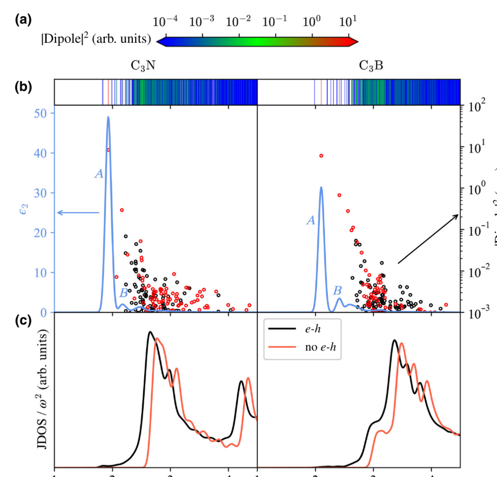

课题组合作研究揭示单层 C₃N 与 C₃B 中近乎平行的价带和导带可诱导异常强烈的窄带激子吸收，相关成果发表于 *Physical Review Applied*。

<!--more-->

*图：单层 C₃N 与 C₃B 中激子态振子强度分布、介电函数虚部及态密度对比，显示强窄带激子吸收特征。图源：论文 Fig. 2。*

C₃N 和 C₃B 是两类重要的石墨烯衍生有序二维合金，它们在保持近似蜂窝网络的同时打开了中等带隙。前期准粒子能带研究表明，两者不仅具有适合电子学和光电应用的带隙，而且在能带边附近呈现出一些非常特别的色散特征。一个自然的问题是：这些电子结构特征是否会在光学响应和激子物理中放大，并产生不同于常规二维半导体的吸收行为？

该工作采用 GW+BSE 多体微扰理论系统研究了单层 C₃N 和 C₃B 的激子谱。研究发现，两种材料中主要由 pz 轨道贡献的价带和导带在布里渊区大范围内近乎平行，导致联合态密度显著增强，并在光吸收谱中形成巨大的窄带吸收峰。这种吸收不是许多激子态分散贡献的普通宽峰，而是高度集中在少数强振子强度激子态上。

更进一步的分析显示，单层 C₃N 中两个简并激子态贡献了 5 eV 以下超过 90% 的偶极吸收强度；单层 C₃B 中对应贡献也超过 80%。这种高度集中的激子吸收在常见二维材料中并不多见。研究还揭示了激子束缚能呈现独特的壳层式分布，不同激子系列分别收敛到不同的单粒子激发边，反映出这些蜂窝合金中能带结构与电子-空穴相互作用之间的特殊耦合。

这项研究把 C₃N/C₃B 系列从准粒子能带拓展到激子光谱层面，说明其价值不只是“有带隙的类石墨烯材料”，更是具有可识别、可利用窄带光学响应的低维激子平台。这为后续进一步设计 C₃B/C₃N 异质结中的低能层间激子吸收奠定了直接基础。

论文信息：Zhao Tang, Greis J. Cruz, Yabei Wu, Weiyi Xia, Fanhao Jia, Wenqing Zhang, and Peihong Zhang, *Physical Review Applied* **17**, 034068 (2022). DOI: [10.1103/PhysRevApplied.17.034068](https://doi.org/10.1103/PhysRevApplied.17.034068)。
