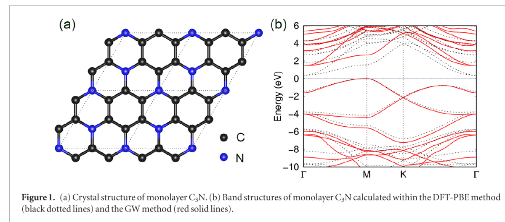

课题组围绕石墨烯衍生二维半导体 C₃N 的真实电子结构开展系统研究，相关成果以 “Quasiparticle electronic structure of honeycomb C₃N: from monolayer to bulk” 为题发表于 *2D Materials*。

<!--more-->

*图：单层 C₃N 的晶体结构，以及 DFT-PBE 与 GW 方法得到的能带结构对比。图源：论文 Fig. 1。*

石墨烯具有高迁移率和稳定的蜂窝晶格，但其零带隙特征限制了其在半导体器件中的直接应用。通过在石墨烯骨架中引入有序氮原子形成 C₃N，是打开带隙同时尽量保留蜂窝网络优势的一条重要路径。然而，对低维材料而言，常规密度泛函理论往往低估带隙，且层间耦合与介电屏蔽会显著改变准粒子能级。因此，准确理解 C₃N 从单层、双层到块体的电子结构，是评估其器件潜力的关键。

该工作采用密度泛函理论与 GW 多体微扰方法，系统计算了蜂窝状 C₃N 的层数依赖准粒子能带结构。研究发现，单层 C₃N 的 GW 准粒子带隙约为 1.5 eV，明显大于早期实验中由量子点尺寸外推得到的较小带隙值。这一结果提示，C₃N 单层本征带隙可能处于更适合电子学应用的能量范围，也需要更精确的实验表征进一步验证。

进一步地，研究揭示了层间堆叠对 C₃N 电子结构的敏感影响。不同双层堆叠构型下，准粒子带隙可在约 0.87-1.35 eV 范围内变化；而在块体极限中，层间化学耦合与体相介电屏蔽共同作用，使不同堆叠方式可能对应金属性或窄带隙半导体行为。由于若干块体堆叠构型在能量上十分接近，实验制备单一半导体相块体 C₃N 可能受到合成动力学的强烈影响。

这项研究为后续 C₃N/C₃B 系列工作奠定了基础：一方面明确了 C₃N 的准粒子带隙不能简单由普通 DFT 或有限尺寸实验外推判断；另一方面也展示了低维蜂窝材料中“层间耦合-介电屏蔽-堆叠构型”共同调控电子结构的核心物理图像。

论文信息：Yabei Wu, Weiyi Xia, Weiwei Gao, Fanhao Jia, Peihong Zhang, and Wei Ren, *2D Materials* **6**, 015018 (2019). DOI: [10.1088/2053-1583/aaeeaa](https://doi.org/10.1088/2053-1583/aaeeaa)。
